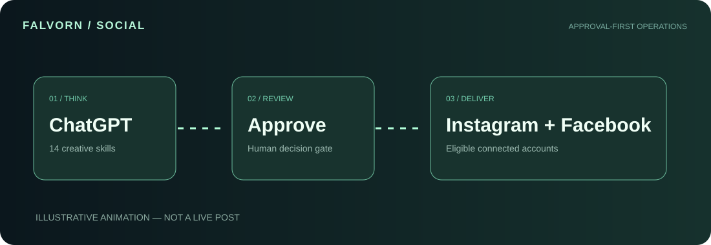

# FALVORN / SOCIAL COPILOT

### Your brand. In motion.

**A ChatGPT-native, human-governed social media creative system for Instagram and Facebook Pages.**

[ChatGPT Plugin](https://chatgpt.com/plugins/plugins_6aee86621324819180a3fcda3276de66) · [Product website](https://falvorn-social-copilot.vercel.app) · [Architecture](docs/ARCHITECTURE.md) · [Security](docs/SECURITY.md) · [Integration guide](docs/INTEGRATIONS.md)

    

## The product

Falvorn Social Copilot turns a creative idea into a clear content workflow, from research and scripting to channel-specific drafts and an explicit approval gate. It consists of a **private ChatGPT plugin** containing 14 original skill instructions and a **public website** that lets visitors explore the experience.

**The source of truth:** The browser website is an interactive, local-only demonstration; it never contacts an AI model or posts to social accounts. Real AI drafting happens within ChatGPT. Publishing to an authorized account is possible only if the third-party PostZen MCP connection is available, the user has connected eligible accounts, and the user approves the exact action.

## Explore the experience

| Surface | Purpose | Current status |
|---|---|---|
| Product website | Responsive 3D-style animated showcase and content studio | Implemented as a public static website |
| Interactive studio | Generate example copy, edit, approve and simulate a scheduled handoff | Browser-local data only |
| Motion film | Animated walk-through recorded with browser Canvas and MediaRecorder | Produced on demand; browser support varies |
| ChatGPT plugin | Reels, research, captions, stories, comments, DM drafting, scheduling workflow | Created as private plugin; 14 skills |
| Instagram / Facebook | Eligible connected account actions through PostZen MCP | Not verified with authenticated social accounts |

[Launch live demo](https://falvorn-social-copilot.vercel.app) · [Open ChatGPT plugin](https://chatgpt.com/plugins/plugins_6aee86621324819180a3fcda3276de66)

## The fourteen specialist skills

| Creative direction | Creation | Management | Delivery |
|---|---|---|---|
| Niche research | Reel scripts | Profile audit | Approval-first publishing |
| Content calendars | Captions | Community engagement | Content audits |
| Brand voice | Carousels | Comment responses | Repurposing |
|  | Stories | DM drafts |  |

All 14 skills live under the plugin/skills directory with their original instructions and shared operating rules.

## Product video and 3D preview

The hero visual uses original CSS 3D transforms, layered floating panels and an animated social mockup, with pointer-based tilt. Press **Watch motion film** to view a cinematic animated walkthrough instantly, and choose **Export video** to record a real downloadable video in browsers supporting MediaRecorder. The film contains only original illustrations; no copied Instagram footage and no real account data.

The animated SVG above illustrates the approval flow and can be viewed in GitHub without running the website.

## Quick start

Requirements: Node.js 20+ for validation. No npm dependency install is required.

1. Clone the repository.
2. From the repository root, run npm run verify.
3. Open site/index.html through a local static server. Example: python -m http.server 8050 --directory site
4. Visit http://localhost:8050/ in a browser. ES modules must be served over HTTP, not opened with a file:// URL.

For production website hosting on Vercel, link this repository, set the **Root Directory** to site, and use a static project (no build command). Git integration deploys pushes to the main branch. See docs/ARCHITECTURE.md and site/vercel.json.

## Connect the ChatGPT plugin

The plugin root is plugin/. Its portable Agent Plugins manifest is plugin/plugin.json; its optional remote connection is plugin/mcp.json. The provider endpoint is https://mcp.postzen.dev/mcp. This is a third-party service that handles OAuth. Install the private plugin in your ChatGPT account and complete connection consent through the provider.

Instagram personal profiles and Facebook personal timelines are not the supported publishing destinations. Instagram must be an eligible professional account and Facebook must be an authorized Page. Available features may differ by permissions. Refer to docs/INTEGRATIONS.md.

## Architecture

- site/index.html, styles.css and app.js: standalone accessible responsive product website
- site/core.mjs: pure draft/approval/scheduling demo state machine
- tests/core.test.mjs: release gate tests
- scripts/check.mjs: static validation
- plugin/skills/: fourteen instruction-driven workflows
- plugin/references/: shared security and brand voice instructions
- .agents/skills/: repository-specific maintainer guidance based on the owner's original GitHub workflow
- .github/workflows/ci.yml: automated verification for pushes and PRs
- docs/: architecture, provider integrations, security and verification ledger

## Trust and release limits

- The website does not use live social metrics, actual AI generation or fake connected account states.
- Approval in the website is a **local demonstration**, not provider authorization.
- Never put social API tokens, cookies or user messages into Git or the public demo.
- Live publishing, OAuth and provider permissions require connected-account testing before production claims.
- Do not use unofficial scraping, cookie automation or mass messaging.

Run npm run verify before a release. Consult [Security](docs/SECURITY.md), [Verification](docs/VERIFICATION.md), and [Changelog](CHANGELOG.md).

## Ownership

**Copyright © 2026 Md Najmul Hossain. All rights reserved.** Original repository code, artwork and skill content are proprietary; see LICENSE. Third-party platforms and services retain their own trademarks and legal terms. This repository does not modify the separate Social-media-automation-agent project and is not affiliated with Meta, Instagram, Facebook, PostZen or OpenAI.
